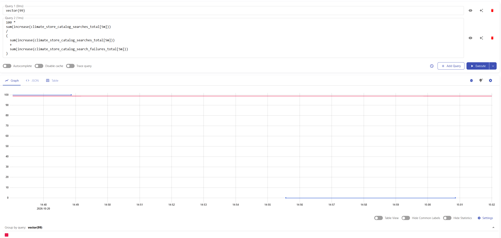
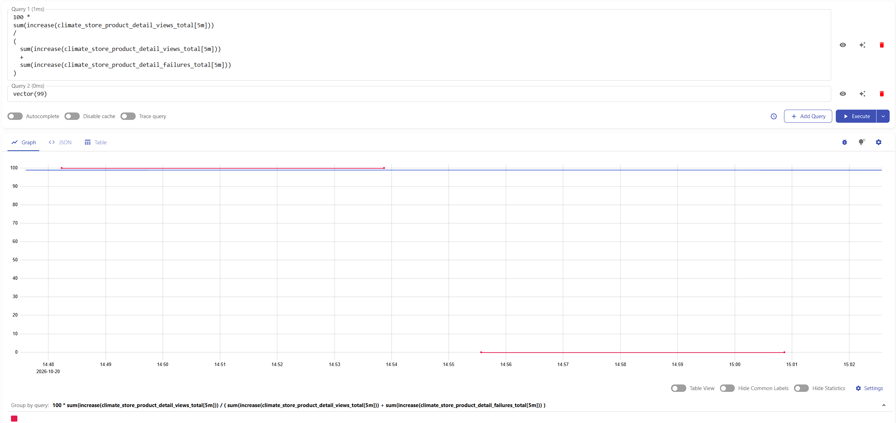
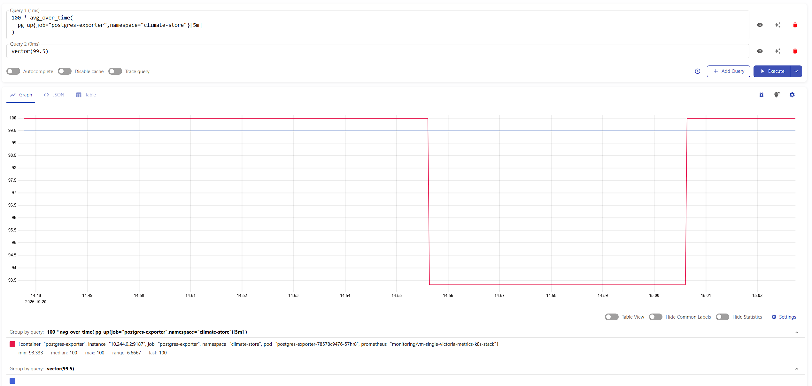
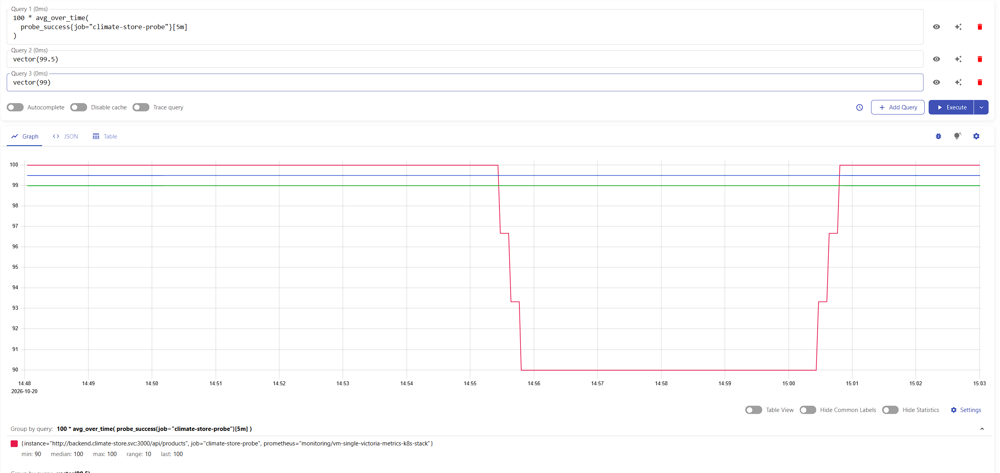

# Отчёт: SLI, SLO и SLA приложения Climate Store

## Что я сделал

Climate Store — учебный интернет-магазин кондиционеров. В нём можно искать модели и смотреть их характеристики. Приложение работает в Minikube, данные хранятся в PostgreSQL.

В этой работе я использовал метрики из прошлого задания, добавил счётчики ошибок и настроил пробер. Затем временно остановил базу и посмотрел, как изменились графики в VictoriaMetrics vmui.

## Выбранные метрики

Из прошлого задания я использовал три метрики:

| Метрика | Что показывает |
| --- | --- |
| `climate_store_catalog_searches_total` | Количество успешных поисков в каталоге |
| `climate_store_product_detail_views_total` | Количество успешных открытий карточки товара |
| `pg_up` | Результат проверки подключения к PostgreSQL: 1 — подключение успешно, 0 — ошибка |

Также я добавил `climate_store_catalog_search_failures_total` и `climate_store_product_detail_failures_total`. Они считают поиски и открытия карточки, завершившиеся ошибкой сервера 5xx. Ошибки 4xx, например запрос несуществующего товара, в расчёт не входят.

Пробер отдаёт метрику `probe_success`: 1 — каталог ответил успешно, 0 — проверка не прошла. Дополнительно я проверял `up`: она показывает, удалось ли собрать результат самого пробера.

## Подход к расчёту

Для поиска и карточки используется RBSLO — доля успешных запросов среди успешных запросов и ошибок сервера.

Для базы и каталога я считаю долю успешных проверок. При регулярном сборе это примерно показывает доступность по времени. Отдельно делить минуты на «хорошие» и «плохие», как в TBSLO, я не стал.

Для демонстрации графики считаются за последние 5 минут. Цели SLO и SLA заданы на календарный месяц, поэтому по короткому эксперименту нельзя оценить результат за весь месяц.

## SLI и SLO

SLI — фактическое значение показателя. SLO — внутренняя цель, с которой сравнивается этот показатель.

| Показатель | Формула SLI за период | Предлагаемый SLO за календарный месяц |
| --- | --- | --- |
| Успешность поиска | Успешные поиски / (успешные поиски + поиски с 5xx) × 100% | Не менее 99% |
| Успешность открытия карточки | Успешные открытия / (успешные открытия + открытия с 5xx) × 100% | Не менее 99% |
| Доступность PostgreSQL | Успешные проверки подключения / все полученные проверки подключения × 100% | Не менее 99,5% |
| Доступность каталога по HTTP | Успешные HTTP-проверки / все полученные HTTP-проверки × 100% | Не менее 99,5% |

### 1. Успешность поиска

Запрос в vmui для демонстрационного окна:

```promql
100 *
sum(increase(climate_store_catalog_searches_total[5m]))
/
(
  sum(increase(climate_store_catalog_searches_total[5m]))
  +
  sum(increase(climate_store_catalog_search_failures_total[5m]))
)
```

`increase` показывает, насколько вырос счётчик за 5 минут, и учитывает его сброс при перезапуске. Порог SLO добавлен запросом `vector(99)`.



Сначала успешность поиска была 100%. Во время сбоя в окне остались только неудачные поиски, поэтому показатель стал 0%. Если запросов за 5 минут нет, получается 0 / 0 и на графике появляется разрыв.

### 2. Успешность открытия карточки

```promql
100 *
sum(increase(climate_store_product_detail_views_total[5m]))
/
(
  sum(increase(climate_store_product_detail_views_total[5m]))
  +
  sum(increase(climate_store_product_detail_failures_total[5m]))
)
```

Порог SLO: `vector(99)`.



После остановки базы показатель снизился до 0%: в этом окне были только ошибки открытия карточки. Это не означает, что сбой длился все пять минут.

### 3. Доступность PostgreSQL

```promql
100 * avg_over_time(
  pg_up{job="postgres-exporter",namespace="climate-store"}[5m]
)
```

Среднее значение `pg_up` показывает долю успешных проверок базы. Порог SLO: `vector(99.5)`.



Во время проверки доступность снизилась примерно до 93,33%, затем вернулась к 100%, когда ошибки вышли из окна 5 минут.

### 4. Доступность каталога по HTTP

```promql
100 * avg_over_time(
  probe_success{job="climate-store-probe"}[5m]
)
```

На этот же график добавлены `vector(99.5)` для SLO и `vector(99)` для порога SLA.



Доступность каталога снизилась до 90%, затем вернулась к 100%. Линии SLO и SLA постоянные, а фактический SLI меняется в зависимости от работы приложения.

## SLA приложения

Для приложения я выбрал учебное SLA: доступность API каталога должна быть не ниже 99% за календарный месяц. Успешной считается проверка, при которой `/api/products` возвращает HTTP 200 не дольше чем за 5 секунд, а ответ начинается с JSON-массива. Проверяется работа API и базы; интерфейс в браузере эта проверка не охватывает.

Формула для завершённого календарного месяца:

```text
Доступность = успешные HTTP-проверки за месяц / все полученные HTTP-проверки за месяц × 100%
```

```text
SLA выполнено, если доступность ≥ 99% и данные мониторинга покрывают период оценки.
```

Если месячный показатель ниже 99%, SLA считается нарушенным: нужно зафиксировать сбой и разобрать его причину. Это учебный пример соглашения, реального договора с клиентом нет. Общий SLA для всех показателей я не задавал.

Бюджет ошибок для SLA составляет 1% проверок, для SLO каталога — 0,5%. При непрерывных проверках за 30 дней это примерно 432 и 216 минут недоступности соответственно.

Формула бюджета ошибок по проверкам:

```text
Допустимые неуспешные проверки = число проверок × (1 − целевой процент / 100).
```

Падение ниже 99% на графике за 5 минут само по себе ещё не означает нарушение месячного SLA.

## Как работает пробер

Для проверок я установил Blackbox Exporter `v0.28.0` в namespace `monitoring`. Настройки сохранены в `k8s/09-blackbox-exporter.yaml`. Там описаны ConfigMap, Deployment, Service и VMProbe.

Каждые 10 секунд пробер отправляет GET-запрос к `http://backend.climate-store.svc:3000/api/products`. На ответ даётся 5 секунд. Он проверяет статус 200 и начало массива в ответе, но не проверяет все данные товаров.

Я выбрал каталог, потому что он обращается к базе. Обычный `/health` отвечает успешно и без PostgreSQL. Пробер работает внутри кластера, поэтому доступность из интернета отдельно не проверяется.

Метрики собирает vmagent и отправляет в VictoriaMetrics. Графики я открыл в vmui. Во время сбоя `probe_success` менялся 1 → 0 → 1, а `up` оставался равен 1 — сам сбор продолжал работать.

## Изменения и демонстрация

Я добавил счётчики ошибок в `backend/src/metrics.ts`, а их обновление — в `backend/src/app.ts`. При пробном отключении базы выяснилось, что backend мог завершиться из-за ошибки соединения. Поэтому в `backend/src/db/index.ts` я добавил обработчик ошибок пула PostgreSQL и ограничил ожидание подключения тремя секундами. Затем собрал образ `climate-store-backend:1.4` и обновил backend в Kubernetes. Проверка `npm run lint -w backend` прошла без ошибок.

Сборка выполнялась обычным Docker, поскольку сборка внутри Minikube сильно нагружала компьютер:

```bash
docker build --progress=plain -t climate-store-backend:1.4 -f backend/Dockerfile .
minikube image load climate-store-backend:1.4
kubectl apply -f k8s/05-backend.yaml
kubectl rollout status deployment/backend -n climate-store
```

Сначала я выполнил успешные поиски и открытия карточки товара. Затем временно остановил PostgreSQL:

```bash
kubectl scale statefulset/postgres --replicas=0 -n climate-store
kubectl wait --for=delete pod/postgres-0 -n climate-store --timeout=60s
```

Во время остановки я повторил запросы поиска и карточки. Счётчики ошибок увеличились, а пробер заметил недоступность каталога. После этого я восстановил базу:

```bash
kubectl scale statefulset/postgres --replicas=1 -n climate-store
kubectl wait --for=condition=Ready pod/postgres-0 -n climate-store --timeout=120s
```

Данные базы сохранились в PVC. Для скринкаста я повторил этот эксперимент: показал нормальную работу, остановку базы, ошибки запросов, изменение графиков и восстановление. Показатели за 5 минут возвращаются к 100%, когда неудачные проверки выходят из этого окна. Запись приложена к отчёту в архиве под названием `Скринкаст-HW5.mp4`. Скриншоты в отчёте сделаны во время предварительной проверки; значения на видео могут отличаться, поскольку эксперимент выполнялся повторно.

## Что нужно учитывать

- Счётчики учитывают только успешные запросы и ответы 5xx. Обрывы соединений и запросы, которые не дошли до backend, они не видят.
- Если запросов нет, на графиках поиска и карточки может быть разрыв.
- Пропуски сбора не считаются автоматически нулями. Их нужно проверять отдельно. Очень короткий сбой между проверками тоже может быть пропущен.
- Сейчас метрики хранятся 7 дней. Для проверки SLA за полный месяц срок хранения нужно увеличить, например до 35 дней, и собирать данные весь месяц.

## Итог

Я настроил четыре SLI для Climate Store, выбрал цели SLO и сформулировал учебное SLA. Проверил расчёты временной остановкой PostgreSQL. На графиках появились ошибки и снижение доступности, а после восстановления показатели вернулись к норме. Скриншоты эксперимента добавлены в отчёт.
