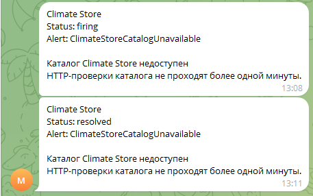
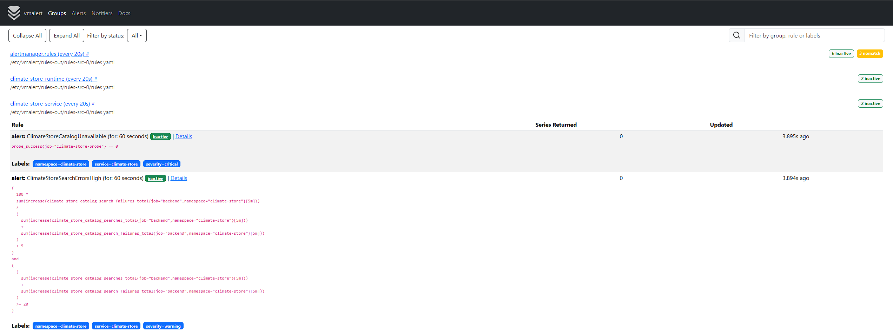
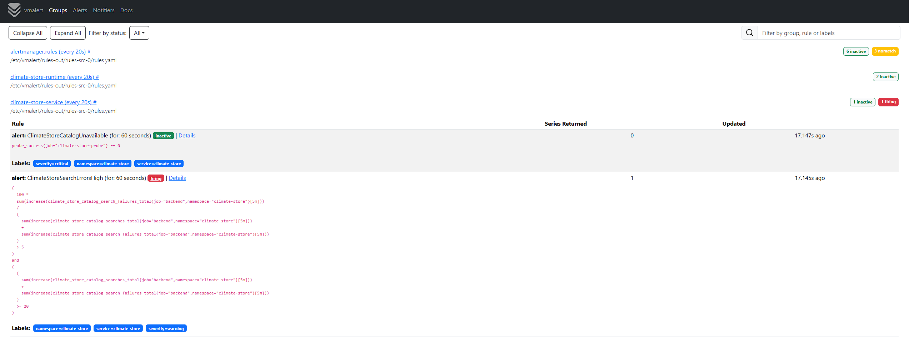
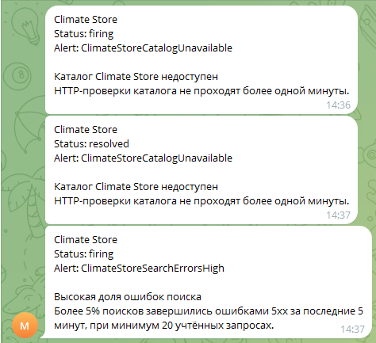
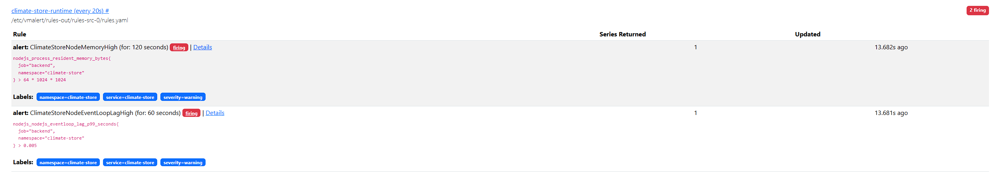
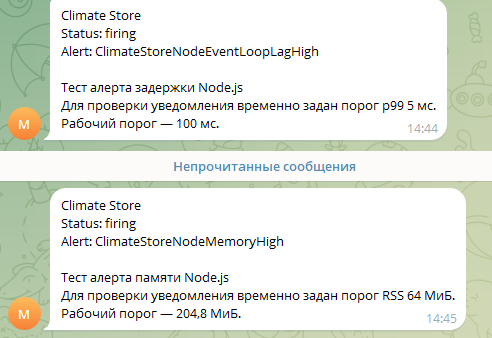

# Алерты для Climate Store

В этой работе я добавил алерты для своего приложения Climate Store. Использовал уже установленный мониторинг: VictoriaMetrics хранит метрики, vmalert проверяет условия, а Alertmanager отправляет сообщения в Telegram.

## Какие алерты выбрал

Я настроил два алерта на работу приложения и два на Node.js, поскольку backend проекта написан на этом рантайме.

| Алерт | Когда срабатывает | Зачем нужен |
| --- | --- | --- |
| Каталог недоступен | Пробер получает ошибки в течение 1 минуты | Чтобы заметить, что пользователь не может открыть каталог |
| Много ошибок поиска | Более 5% запросов поиска завершаются ошибкой 5xx за 5 минут, при минимум 20 запросах. Условие сохраняется 1 минуту | Чтобы обнаружить проблемы с поиском и не реагировать на одну случайную ошибку |
| Высокое потребление памяти | RSS процесса Node.js выше 204,8 МиБ в течение 2 минут | Чтобы предупредить о высоком расходе памяти: лимит контейнера — 256 МиБ |
| Задержка event loop | Задержка p99 выше 100 мс в течение 1 минуты | Чтобы заметить, что Node.js может медленно обрабатывать запросы |

Для каталога я выбрал уровень `critical`, для остальных — `warning`. Проверка условий выполняется каждые 20 секунд. Задержка перед срабатыванием нужна, чтобы короткие скачки не вызывали лишние уведомления.

Для правил использовал `probe_success`, счётчики успешных и неудачных поисков, `nodejs_process_resident_memory_bytes` и `nodejs_nodejs_eventloop_lag_p99_seconds`. Доля ошибок поиска считается как число ошибок, делённое на сумму успешных запросов и ошибок за тот же период.

## Уведомления

Я создал Telegram-бота и подключил его через Alertmanager. Сообщения отправляются только для алертов Climate Store. При срабатывании приходит `firing`, после восстановления — `resolved`. Повторное уведомление о продолжающемся сбое настроено раз в час.

Токен бота хранится в Kubernetes Secret, в архиве его нет. Рабочие правила находятся в `configs/10-alert-rules.yaml`, настройки уведомлений — в `configs/11-alertmanager-telegram.yaml`. Конфигурация пробера тоже приложена.

## Как проверял

Сначала я временно остановил PostgreSQL. Каталог перестал отвечать успешно, и через минуту сработал алерт недоступности. После запуска базы пришло сообщение о восстановлении.

Условия сервисных алертов в vmalert:

Затем при выключенной базе я выполнил 30 запросов поиска. Они вернули ошибки 5xx, после чего сработал второй алерт. Его состояние и уведомление показаны ниже.

Для проверки алертов Node.js я использовал отдельный файл `alert-rules-test.yaml`. В нём временно снизил порог памяти до 64 МиБ, а задержки — до 5 мс. Оба алерта сработали на реальных метриках приложения, сообщения пришли в Telegram.

Это была проверка правил и доставки сообщений с тестовыми порогами, а не реальная перегрузка приложения. После теста я вернул рабочие значения: 204,8 МиБ и 100 мс. PostgreSQL также восстановлен.

## Вывод

Я настроил и проверил четыре алерта. По уведомлениям можно понять, что произошло с каталогом, поиском или Node.js. Скриншоты срабатываний и использованные конфигурации добавлены в архив.
