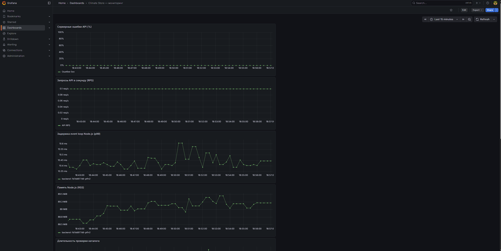
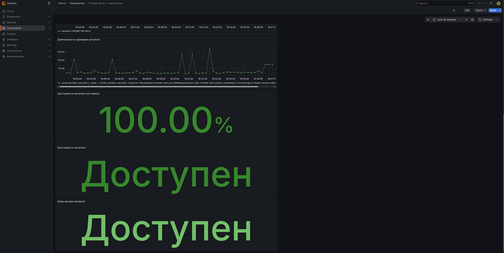
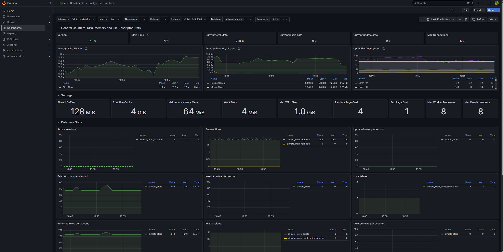
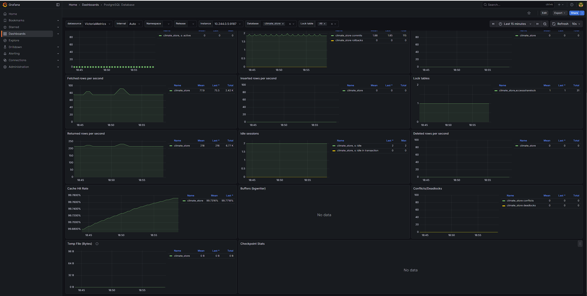

# Дашборды Grafana для Climate Store
В этой работе я собрал дашборд для своего приложения Climate Store и импортировал готовый дашборд PostgreSQL. Grafana уже была установлена в Minikube после задания по логам, поэтому я использовал её повторно.

## Источники данных

Для метрик я добавил источник VictoriaMetrics типа Prometheus. Grafana подключается к нему по внутреннему адресу Kubernetes:

```text
http://vmsingle-vm-single-victoria-metrics-k8s-stack.monitoring.svc:8428
```

Метрики backend, PostgreSQL Exporter и HTTP-пробера собирает vmagent. Ранее настроенный источник VictoriaLogs остался для логов, в этих дашбордах он не используется.

## Дашборд приложения

Я добавил восемь панелей:

| Панель | Что показывает и зачем нужна |
| --- | --- |
| Сбор метрик backend | Значение `up`: удаётся ли мониторингу получить метрики приложения |
| Доступность каталога | Текущий результат проверки `probe_success`: отвечает ли каталог |
| Доступность каталога за 5 минут | Долю успешных проверок с порогами SLA и SLO |
| Запросы API в секунду | RPS по счётчику `climate_store_http_requests_total`, чтобы видеть нагрузку |
| Серверные ошибки API | Процент ответов 5xx, чтобы замечать сбои |
| Длительность проверки каталога | Время HTTP-проверки `probe_duration_seconds` |
| Память Node.js (RSS) | Потребление памяти процессом backend |
| Задержка event loop Node.js (p99) | Задержку обработки событий Node.js |

При выборе панелей я ориентировался на RED и Golden Signals: нагрузку, ошибки и задержки. Для детализации добавил память и event loop. Длительность пробера показывает время всей проверки каталога, а не время каждого пользовательского запроса. `up` показывает состояние сбора метрик и сам по себе не гарантирует, что каталог работает.

Для RPS и ошибок я добавил в backend общий HTTP-счётчик с метками метода и кода ответа. Он учитывает завершённые запросы к `/api/`, включая запросы пробера. Проверки `/health` и сбор `/metrics` в него не входят. Backend обновлён до образа `climate-store-backend:1.5`.





## Панель SLA пробера

Для отдельной панели использован расчёт из прошлого задания:

```promql
100 * avg_over_time(
  probe_success{job="climate-store-probe"}[5m]
)
```

Это процент успешных проверок за последние пять минут. Цвета панели: ниже 99% — красный, от 99% — жёлтый, от 99,5% — зелёный. Порог SLA — 99%, внутренняя цель SLO — 99,5%.

Месячный SLA из прошлого задания и значение за пять минут — разные периоды. Здесь короткое окно используется для демонстрации; оно не подтверждает выполнение SLA за месяц. Пропуски сбора также нельзя автоматически считать успешными проверками.

## Дашборд PostgreSQL

Я импортировал [PostgreSQL Database, ID 21144](https://grafana.com/grafana/dashboards/21144-postgresql-database/) и выбрал тот же источник VictoriaMetrics. Для просмотра данных приложения используется база `climate_store`.

На дашборде видны транзакции, сессии, чтение и изменение строк, блокировки и cache hit rate. Некоторые запросы пришлось поправить: убрать фильтр `!= 0`, который скрывал нулевые значения, и заменить единицы «байты» на количество строк. Для операций со строками используется `rate`, чтобы показывать изменения в секунду.

В импортированном шаблоне остались дополнительные панели с `No data`, например Buffers и Checkpoint Stats. Их работоспособность в этой работе не подтверждалась. Для демонстрации я использовал панели, на которых данные действительно поступают. Верхние общие панели шаблона также не использовались для выводов о ресурсах самой базы.





## Проверка и результат

Я выполнил серию запросов поиска и увидел рост RPS. Затем ненадолго остановил PostgreSQL: API стал возвращать 500, и доля серверных ошибок на графике выросла. После проверки база была восстановлена. На скриншотах показано уже нормальное состояние приложения.

В короткой записи экрана я показал дашборд приложения и импортированный дашборд PostgreSQL. JSON обоих дашбордов приложен, чтобы их можно было импортировать повторно. При импорте нужно выбрать свой источник VictoriaMetrics, а в PostgreSQL-дашборде — актуальный экземпляр экспортера и базу.

В результате основные показатели приложения, доступность по проберу и статистику PostgreSQL можно просматривать в Grafana. В архив входят этот отчёт, два JSON, четыре скриншота и скринкаст.
