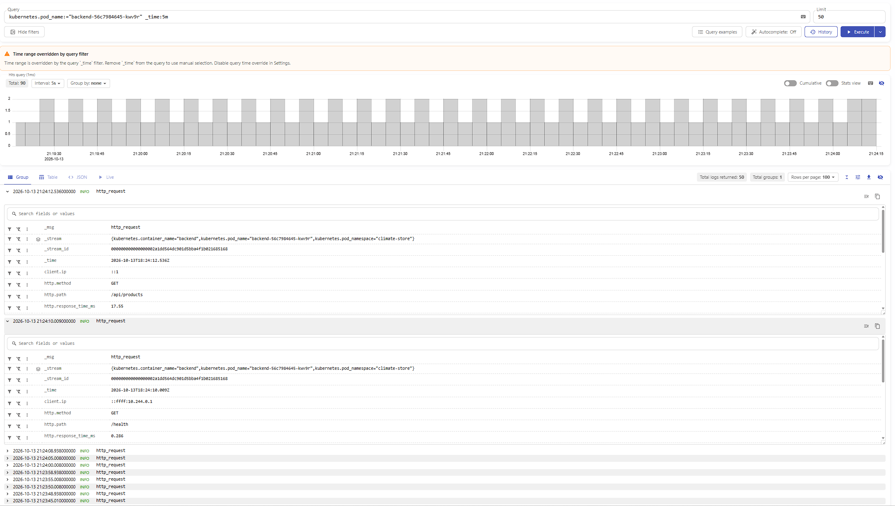
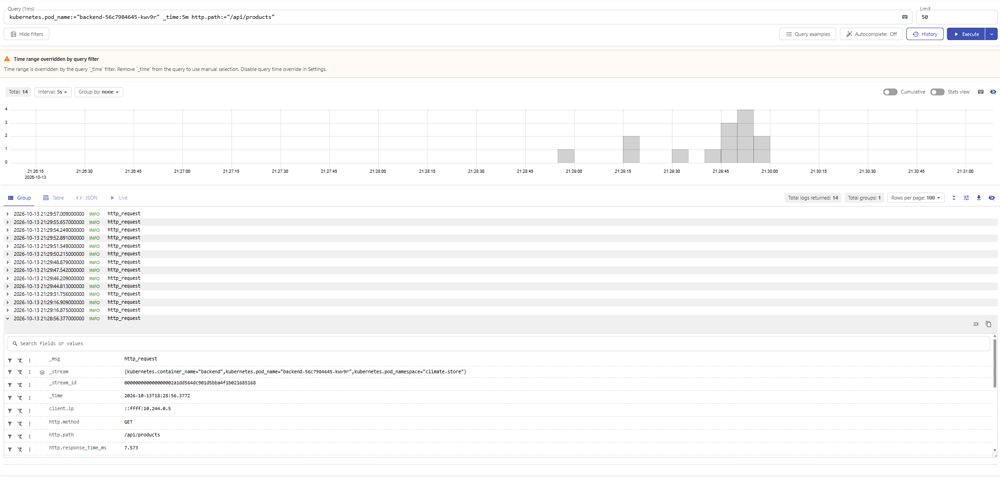
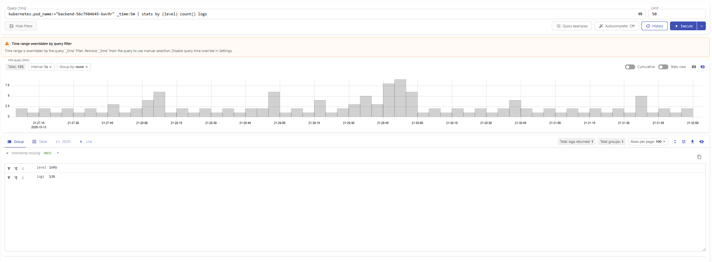
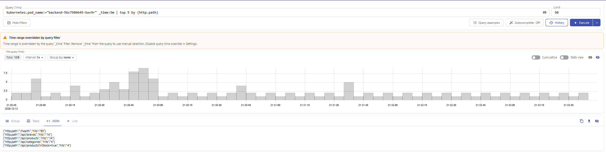
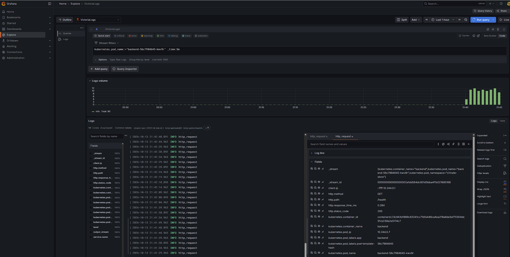

# Отчёт

## Приложение и окружение

Climate Store — учебный интернет-магазин кондиционеров. Приложение развёрнуто в однодовом кластере Minikube в namespace `climate-store`. Backend на Express пишет HTTP-логи в stdout контейнера в формате JSON. В записи используются поля `timestamp`, `level`, `message`, `service.name`, `http.method`, `http.path`, `http.status_code`, `http.response_time_ms` и `client.ip`.

В каталоге `config/` приложены код JSON-логирования backend и его Kubernetes Deployment. Secret с паролями и строкой подключения к PostgreSQL не включён.

## Доставка логов

VictoriaLogs Single развёрнута официальным Helm-чартом `victoria-logs-single` в namespace `climate-store` с хранением данных в PVC объёмом 1 GiB и сроком хранения 7 дней.

Для сбора использован официальный чарт `victoria-logs-collector` версии `0.3.8`. Он запускает `vlagent` как DaemonSet: сборщик читает логи контейнеров на узле Minikube, добавляет Kubernetes-метаданные и отправляет записи в VictoriaLogs через native ingestion endpoint `/insert/native`. В однодовом кластере работает один экземпляр DaemonSet.

Адрес приёма внутри кластера:

```text
http://vlogs-victoria-logs-single-server.climate-store.svc:9428/insert/native
```

Этот способ выбран потому, что DaemonSet автоматически собирает stdout/stderr контейнеров на узле и подходит для Kubernetes без изменения сетевого взаимодействия приложения. Конфигурация исключает namespace `kube-system` и сам Pod сборщика, чтобы не собирать системный шум и не отправлять логи агента самому себе. Настройки находятся в `config/victoria-logs-collector-values.yaml`.

Доставка проверена в vmui: запрос по `kubernetes.pod_name` вернул логи backend, в том числе записи `/api/products`, а раскрытие записи показало распознанные поля HTTP-запроса и Kubernetes-метаданные. Частые `/health` — это обращения liveness/readiness probes Kubernetes.

## Запросы LogsQL

Запросы выполнены в vmui за последние пять минут. В фильтре используется имя backend Pod, действовавшее во время выполнения запросов; при повторном запуске оно может измениться.

### 1. Сырые записи backend за последние пять минут

```logsql
kubernetes.pod_name:="backend-56c7984645-kwv9r" _time:5m
```

Показывает исходные записи выбранного backend Pod за временной интервал. Среди них видны запросы приложения и проверки `/health` от Kubernetes.



### 2. Фильтр по полю `http.path`

```logsql
kubernetes.pod_name:="backend-56c7984645-kwv9r" _time:5m http.path:="/api/products"
```

Оставляет только записи HTTP-запросов к каталогу кондиционеров. В vmui найдено 14 таких записей за выбранный интервал.



### 3. Количество логов с группировкой по уровню

```logsql
kubernetes.pod_name:="backend-56c7984645-kwv9r" _time:5m | stats by (level) count() logs
```

Считает количество записей для каждого значения `level`. Во время выполнения все 135 записей backend имели уровень `info`.



### 4. Пять наиболее частых HTTP-путей

```logsql
kubernetes.pod_name:="backend-56c7984645-kwv9r" _time:5m | top 5 by (http.path)
```

Показывает пять значений `http.path` с наибольшим числом записей. В момент выполнения наиболее частым был `/health` (90 записей), далее `/api/brands` и `/api/products` (по 14). Это иллюстрирует и работу API, и частоту Kubernetes probes.



## Бонус: Grafana

Дополнительно развёрнута Grafana с официальным datasource-плагином VictoriaLogs (`victoriametrics-logs-datasource`). Источник настроен через Helm values и обращается к VictoriaLogs по внутреннему адресу Service. В Explore выполнен LogsQL-запрос к логам backend.


